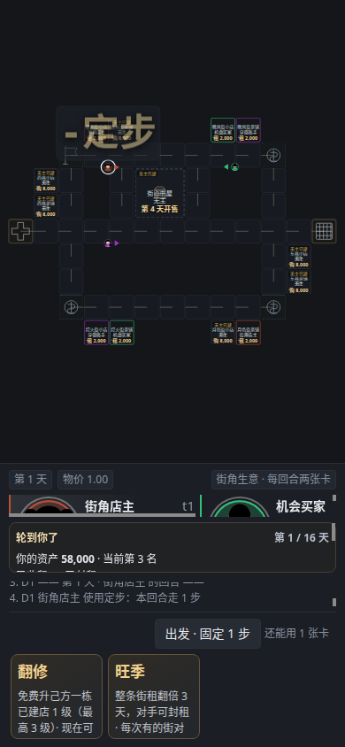
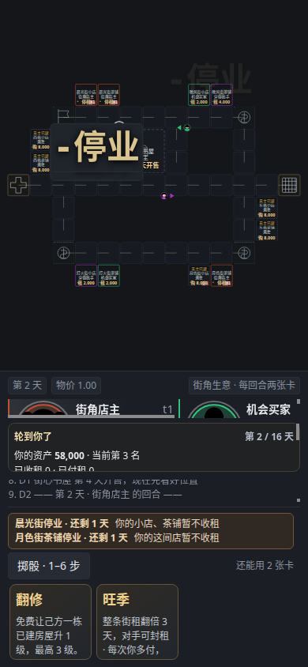
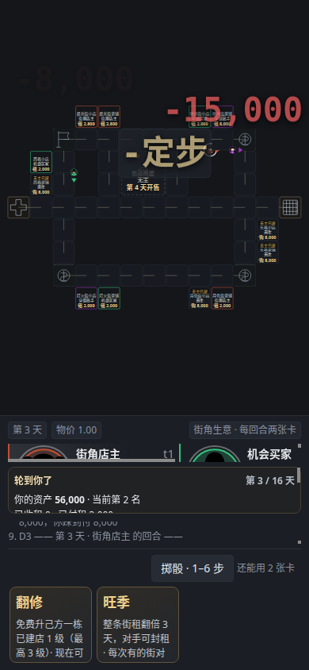

# 手机试玩：定步、买店、停业

## 在普通页面复玩

1. 在检出目录运行 `python3 -m http.server --bind 127.0.0.1 8000`，打开 `http://127.0.0.1:8000/?slice=1&style=grow&seed=19`。保持「争街」，不要勾选「开门营业」，按「开一局街角生意」。
2. 第 1 天按「定步」→「1 步」（落点预览为晨光街茶铺）。按钮变成「出发 · 固定 1 步」，此时还没有移动。点「出发」，以 8,000 买下晨光街茶铺。
3. 机会买家打出停业卡。回到你时已是第 2 天，行动键上方显示「晨光街停业 · 还剩 1 天」「你的小店、茶铺暂不收租」。被停业的是整条晨光街；对手在停业期内落到这两家店，都不用付租。这不是立即从你账上扣钱。另一个对手在月色街打了停业，月色街茶铺的影响单列。
4. 第 2 天行动键恢复为「掷骰 · 1–6 步」。按它，两次岔路都选「向右」；第 3 天晨光街的停业提示已消失。

## 可重跑的触屏检查

先启动上面的本地静态服务。用 Node 22+ 和已安装的 Chrome/Chromium 执行（必要时用 `CHROME` 指定浏览器）：

```sh
node support/mobile-opening.mjs 8000 /tmp/street-390
VIEWPORT_W=360 VIEWPORT_H=640 node support/mobile-opening.mjs 8000 /tmp/street-360
```

390 × 844 全路线不用滚动。360 × 640 也能玩完，但开局或选较后面的定步选项时可能需要滚动；停业提示不用滚动就能读，移动键也直接可点。短视口的玩家栏本来就会被裁切，这不是本次停业提示造成的，也没有在这次交付里修好。脚本用触屏事件点页面上的正常控件，不设置游戏状态。它核对了出发前的固定步数、实际移动结果、停业卡与买入日志、两条提示完整可见、移动键和手牌可点，以及到期后不再提示晨光街停业、茶铺恢复单次租金 2,800。

以下是 390 × 844 游戏画面：







同伴另走了一条独立触屏路线：第 1 天直接掷到 1 步买店，第 2 天在停业提示仍可见时选定步 2、出发并在岔路向下。另跑了种子 1 的「开门营业」开启局：下一回合和终局回看都保留 +900 实收、−10,000 其他收支、−9,100 净额。
