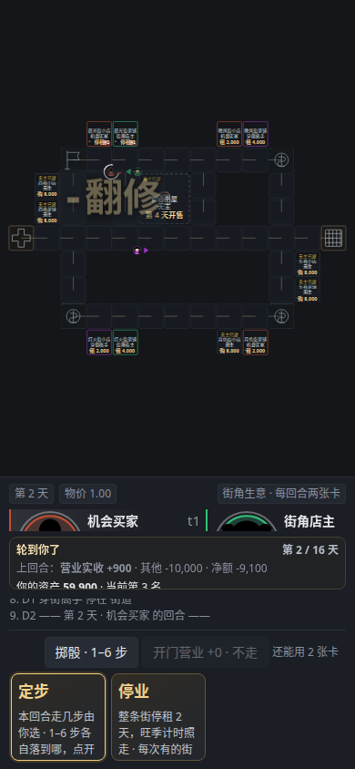
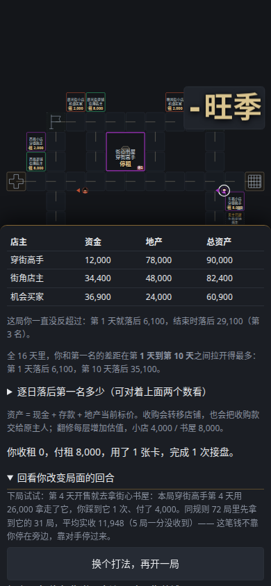

# 营业到账与结算回看

## 用普通入口复玩

在公开仓库的检出目录运行 `python3 -m http.server 8080 --bind 127.0.0.1`，打开 `http://127.0.0.1:8080/?slice=1&seed=1`。保持「争街」，选「机会买家」，勾选「实验规则：开门营业」后开局。

1. 第 1 天按「收购」，在棋盘上点晚风街小店，支付 10,000。
2. 同回合按「开门营业 +900 · 不走」。轮到你时，侧栏直接写「营业实收 +900 · 其他 -10,000 · 净额 -9,100」。
3. 继续按普通操作玩到终局，打开「回看你改变局面的回合」。第 1 天显示同样三笔收支，资产变动另列为 -1,100。
4. 另开种子 1 并保持实验关闭。普通玩法也能打到结算，期间没有营业按钮或营业账单。

## 复验记录

从候选的页面、样式和游戏源码单独导出，用 390 × 844 的 Chromium 触摸视口走完开启和关闭两局。前者的侧栏账单位于可见范围内，整行没有被面板裁掉。结算再次读到 +900、-10,000 和 -9,100。两局均无页面异常。

这份复验覆盖实际到账、账单显示、回看和实验开关。账单数值来自实际结算。同回合「其他收支」是逐项到账后的余额差额，明细仍可展开查看。
